# Bayesian RNA Velocity


## Overview

A reproducible computational framework for mechanistic RNA
kinetic modelling, Bayesian parameter inference and
uncertainty-aware RNA velocity estimation.

The project investigates how transcription, splicing and
degradation dynamics influence RNA abundance and velocity,
and how observation noise, sampling density and experimental
design affect parameter recovery and practical identifiability.

The framework combines ordinary differential equations,
numerical optimisation, Bayesian Markov chain Monte Carlo
(MCMC), posterior predictive analysis, sensitivity analysis
and systematic simulation-based robustness evaluation.

## Scientific Objectives

- Develop a mechanistic model of RNA transcription,
  splicing and degradation.
- Estimate kinetic parameters from noisy synthetic observations.
- Quantify parameter uncertainty using Bayesian inference.
- Propagate posterior uncertainty into RNA velocity estimates.
- Investigate parameter sensitivity and practical identifiability.
- Evaluate robustness across experimental conditions.
- Establish computational reproducibility through automated
  testing and regression validation.

## Mathematical Framework

The model describes unspliced RNA abundance (u) and
spliced RNA abundance (s).

$$
\frac{du}{dt} = \alpha - \beta u
$$

$$
\frac{ds}{dt} = \beta u - \gamma s
$$

| Parameter | Biological interpretation | Baseline value |
|---|---|---:|
| Alpha | Transcription rate | 5.0 |
| Beta | Splicing rate | 0.8 |
| Gamma | Degradation rate | 0.4 |

The initial RNA abundances are zero.

At steady state:

$$
u^* = \frac{\alpha}{\beta}
$$

$$
s^* = \frac{\alpha}{\gamma}
$$

The baseline steady-state abundances are 6.25 and 12.5
for unspliced and spliced RNA, respectively.

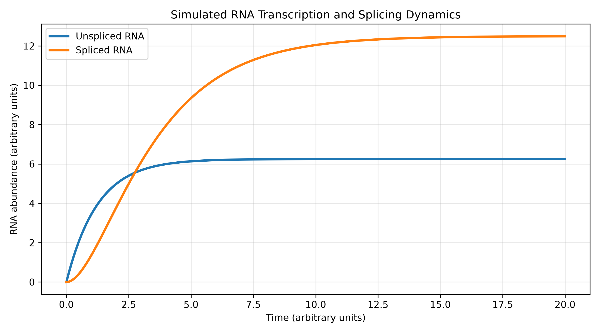

## Computational Workflow

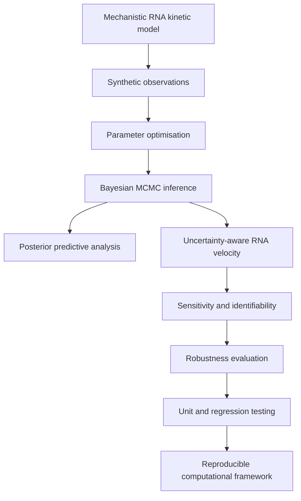

## 1. Synthetic Data Generation

Synthetic RNA trajectories were generated from the
mechanistic kinetic model and perturbed with Gaussian
observation noise.

The baseline dataset contains 25 observation times and
two RNA abundance measurements per time point.

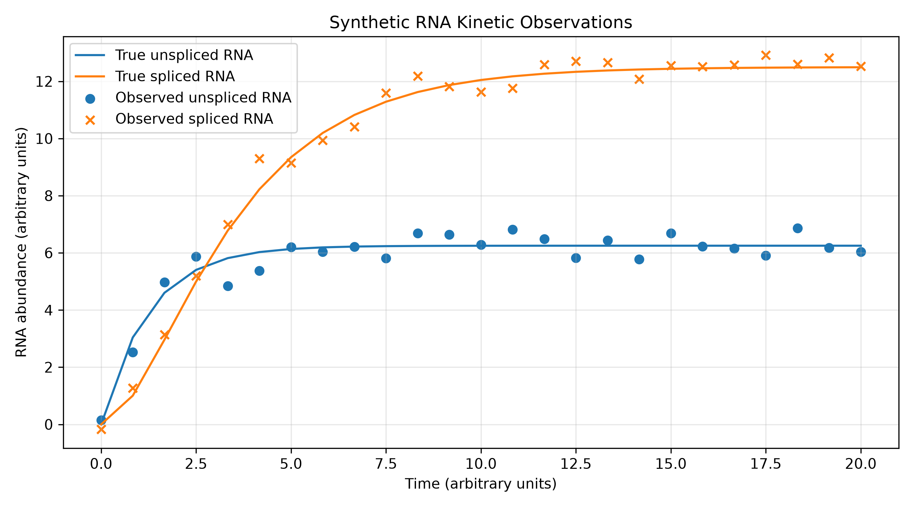

## 2. Parameter Estimation

Kinetic parameters were estimated using nonlinear
least-squares optimisation and numerical ODE integration.

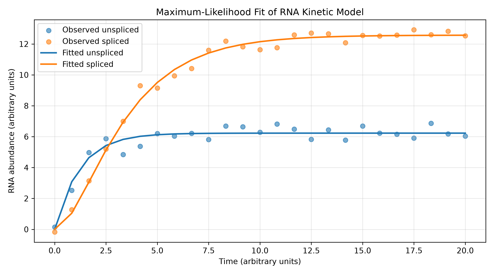

## 3. Bayesian Parameter Inference

Bayesian inference was performed using the emcee
ensemble MCMC sampler.

The statistical model assumes independent Gaussian
observation errors with known standard deviation.

Bounded uniform priors were specified for the three
positive kinetic parameters.

| MCMC configuration | Value |
|---|---:|
| Parameters | 3 |
| Walkers | 32 |
| Sampling steps | 5,000 |
| Burn-in steps | 1,000 |
| Random seed | 42 |

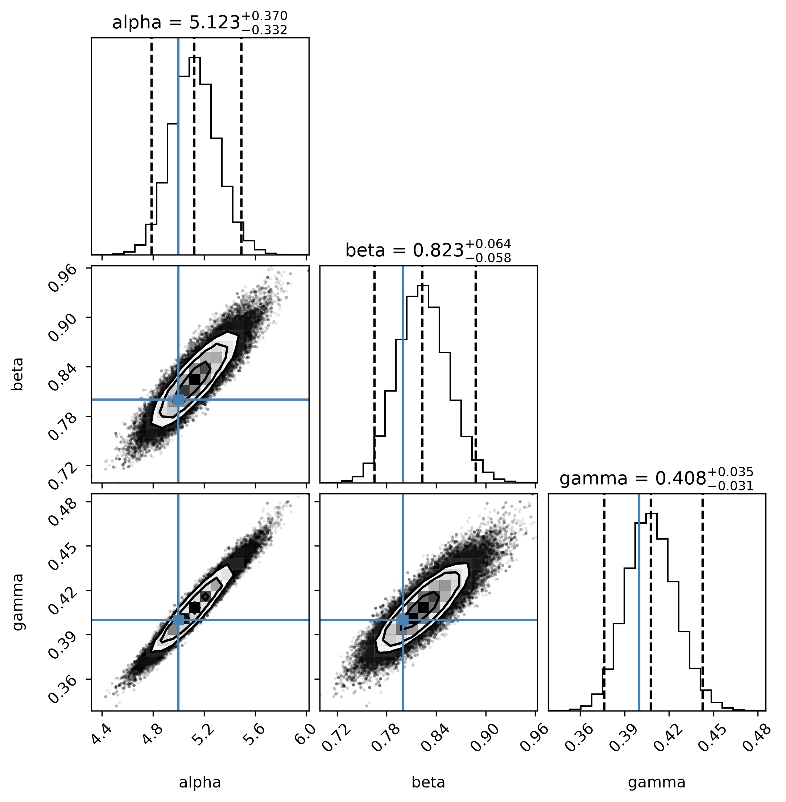

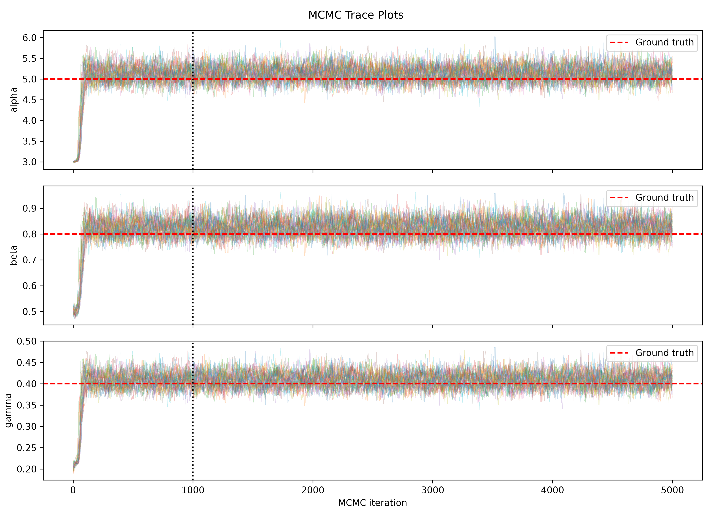

## 4. Posterior Predictive Analysis

Posterior parameter samples were propagated through
the kinetic model to characterise uncertainty in
predicted RNA abundance trajectories.

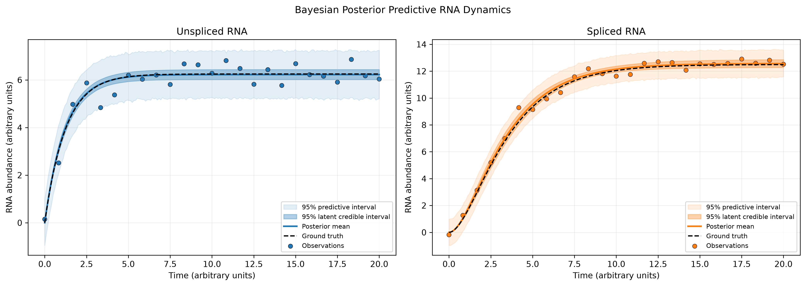

## 5. Bayesian RNA Velocity Estimation

RNA velocity was calculated from the instantaneous
derivatives of unspliced and spliced RNA abundance.

A total of 2,000 posterior parameter draws were
evaluated across 400 time points.

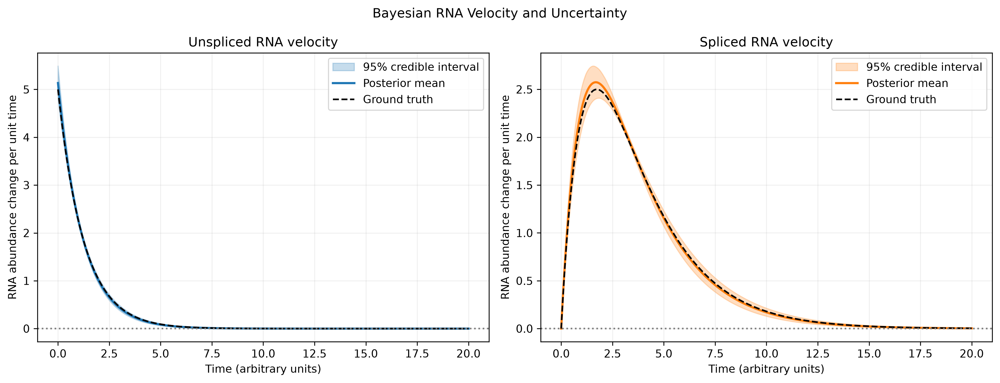

### Velocity reconstruction

| Metric | Unspliced RNA | Spliced RNA |
|---|---:|---:|
| RMSE | 0.017283 | 0.027653 |
| MAE | 0.006766 | 0.016038 |
| Pointwise credible interval coverage | 100% | 100% |

Coverage refers to the known synthetic trajectory
in this particular experiment, rather than calibration
across independently generated datasets.

### Peak spliced RNA velocity

| Quantity | Ground truth | Posterior mean | 95% credible interval |
|---|---:|---:|---|
| Peak magnitude | 2.5000 | 2.5765 | 2.4091–2.7450 |
| Peak time | 1.7329 | 1.6900 | 1.5680–1.8162 |

Both ground-truth quantities were contained within
their respective posterior credible intervals.

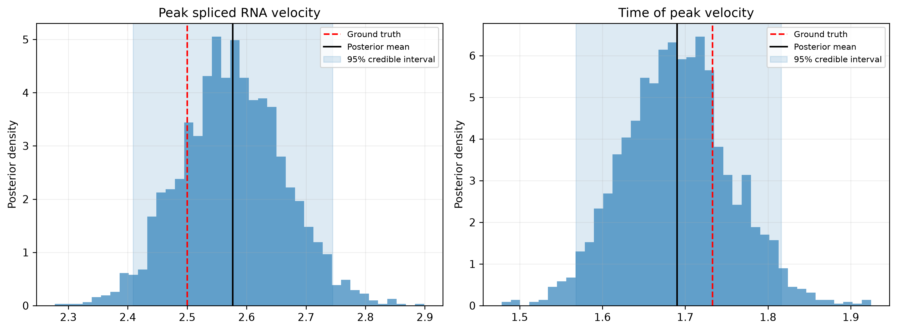

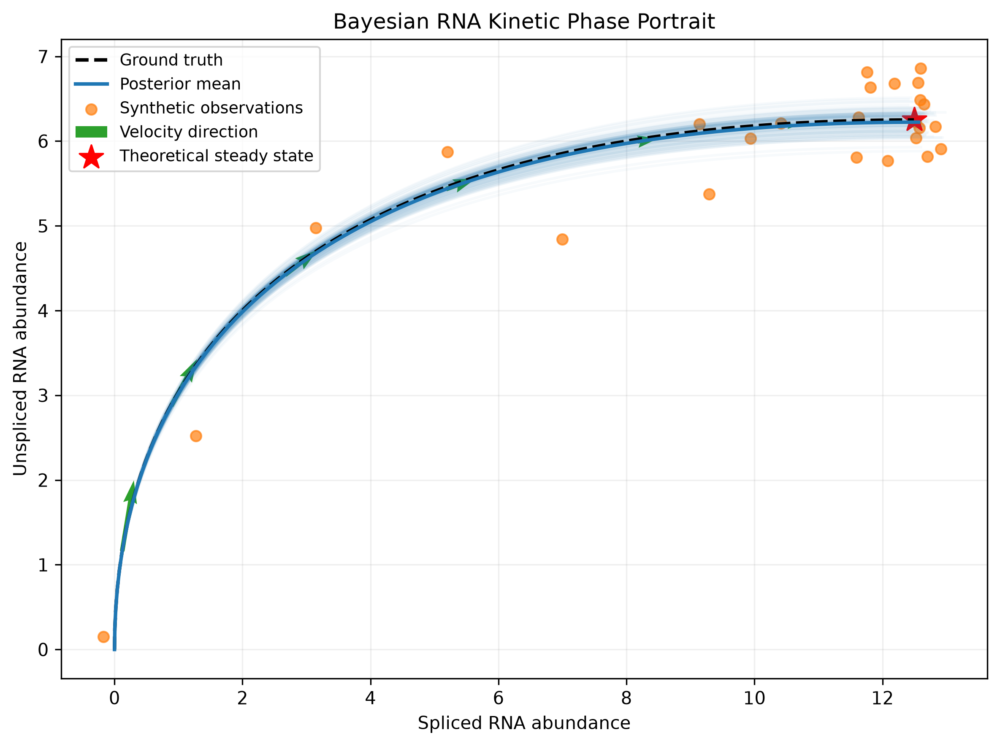

## 6. Sensitivity and Identifiability Analysis

Parameter sensitivity was investigated using central
finite differences, normalised local sensitivities
and parameter perturbation experiments.

Practical identifiability was evaluated using Fisher
information matrices, eigenvalue analysis and
parameter correlations.

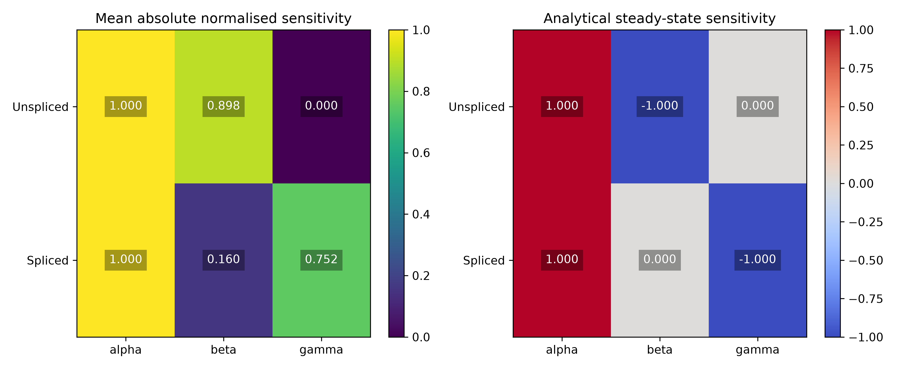

### Mean absolute normalised sensitivities

| RNA abundance | Alpha | Beta | Gamma |
|---|---:|---:|---:|
| Unspliced | 1.000 | 0.898 | 0.000 |
| Spliced | 1.000 | 0.160 | 0.752 |

### Parameter correlations

| Parameter pair | Fisher-based | Bayesian posterior |
|---|---:|---:|
| Alpha–Beta | 0.879 | 0.885 |
| Alpha–Gamma | 0.965 | 0.967 |
| Beta–Gamma | 0.857 | 0.863 |

Strong positive parameter correlations indicate
substantial coupling between kinetic parameter
estimates under the baseline experimental design.

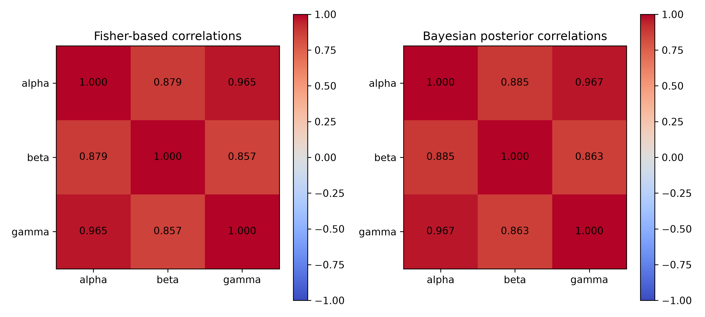

## 7. Robustness Evaluation

A systematic simulation-based benchmark was conducted
using 16 scenario labels with 30 independent noise
realisations per scenario.

A total of 480 optimisation experiments were performed.

The benchmark evaluated:

- Observation noise: 0.1, 0.5, 1.0 and 2.0.
- Sampling density: 10, 25, 50 and 100 observations.
- Five kinetic parameter regimes.
- Uniform, early-enriched and late-enriched sampling.

Some baseline conditions are repeated across scenario
groups. Factors were varied individually rather than
through a complete factorial experimental design.

### Optimisation performance

| Diagnostic | Result |
|---|---:|
| Total experiments | 480 |
| Successful optimisation | 480/480 |
| Full-rank Fisher information | 480/480 |
| Valid local uncertainty estimates | 480/480 |
| Boundary solutions | 0 |

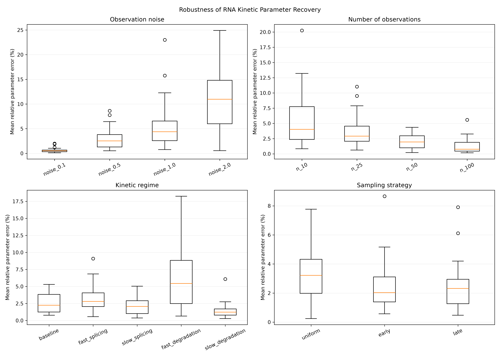

### Effect of sampling density

| Observations | Alpha median error | Beta median error | Gamma median error |
|---|---:|---:|---:|
| 10 | 4.07% | 5.06% | 5.65% |
| 25 | 3.15% | 3.65% | 3.33% |
| 50 | 1.81% | 1.75% | 2.33% |
| 100 | 0.64% | 1.06% | 0.83% |

Increasing sampling density improved parameter
recovery under the simulated conditions.

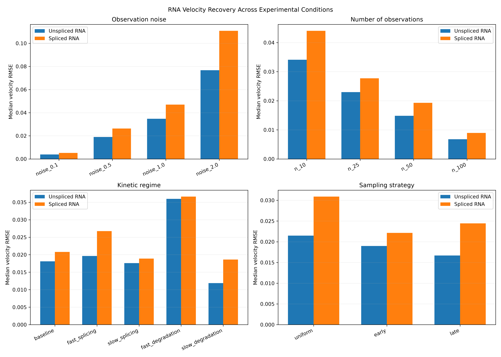

### Effect of sampling design

| Sampling design | Alpha median error | Beta median error | Gamma median error |
|---|---:|---:|---:|
| Uniform | 2.88% | 3.61% | 3.56% |
| Early-enriched | 1.81% | 1.87% | 1.88% |
| Late-enriched | 2.13% | 2.18% | 2.45% |

Early-enriched sampling achieved the lowest median
parameter errors among the evaluated sampling designs.

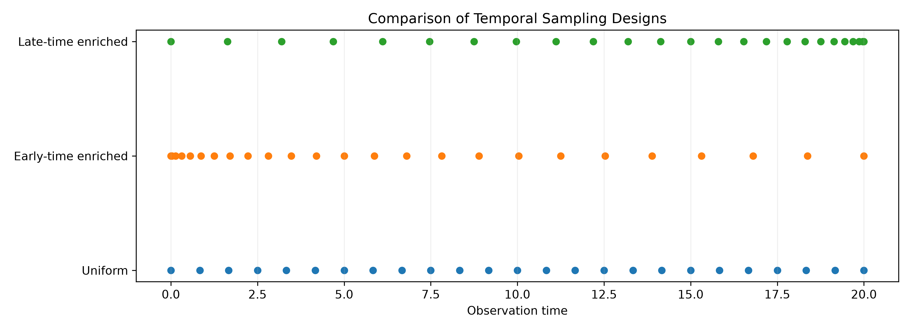

The robustness benchmark uses nonlinear optimisation
and local Fisher-based confidence intervals rather
than independent Bayesian MCMC inference for every
replicate.

## 8. Software Testing and Validation

The computational implementation was refactored into
three reusable and independently tested modules.

| Module | Tests | Statement coverage |
|---|---:|---:|
| rna_kinetics.py | 38 | 100% |
| rna_inference.py | 35 | 100% |
| rna_bayesian.py | 42 | 100% |
| Total | 115 | 100% |

Validation includes:

- Analytical solutions against numerical ODE integration.
- Steady-state behaviour and velocity calculations.
- Parameter recovery across kinetic regimes.
- Fisher information and rank-deficient experiments.
- Gaussian likelihood verification against SciPy.
- Prior boundaries and posterior consistency.
- Invalid input handling.
- Deterministic reproducibility.

Statement coverage applies to the three reusable
modules, not the entire analysis pipeline.

## 9. Regression and Reproducibility Validation

All eight analysis scripts were successfully executed
after refactoring.

| Validation | Result |
|---|---:|
| Analysis scripts executed | 8/8 |
| Numerical outputs reproduced exactly | 20/20 |
| Figures reproduced byte-for-byte | 18/21 |
| Remaining figures visually consistent | 3/3 |
| Unit tests passed | 115/115 |
| Shared module statements covered | 120/120 |

A separate Python virtual environment was created
using the pinned dependency versions.

The complete pipeline was executed from empty data,
results and figures directories. All 20 numerical
outputs, including the full MCMC chain, were reproduced
byte-for-byte.

Validation was conducted on macOS with Python 3.11.0.
Cross-platform reproducibility has not been established.

## Repository Structure

```text
Bayesian-RNA-Velocity/
├── data/
│   └── synthetic_rna_observations.csv
├── figures/
├── results/
├── src/
│   ├── 01_simulate_rna_kinetics.py
│   ├── 02_generate_synthetic_data.py
│   ├── 03_fit_rna_parameters.py
│   ├── 04_bayesian_parameter_inference.py
│   ├── 05_posterior_predictive_analysis.py
│   ├── 06_bayesian_rna_velocity.py
│   ├── 07_sensitivity_identifiability.py
│   ├── 08_robustness_validation.py
│   ├── rna_kinetics.py
│   ├── rna_inference.py
│   └── rna_bayesian.py
├── tests/
│   ├── test_rna_kinetics.py
│   ├── test_rna_inference.py
│   └── test_rna_bayesian.py
├── pytest.ini
├── requirements.txt
├── requirements-lock.txt
├── .gitignore
└── README.md
```

## Installation

Python 3.11.0 was used for the validated environment.

```bash
python3 -m venv .venv
source .venv/bin/activate
python -m pip install -r requirements-lock.txt
python -m pip check
```

The lock file records the complete tested dependency
environment. The requirements file lists the main
scientific and testing dependencies.

## Running the Pipeline

Execute the following commands from the repository root.

```bash
mkdir -p data results figures

export MPLBACKEND=Agg

for script in src/[0-9]*.py; do
    python "$script" || exit 1
done
```

The pipeline regenerates the synthetic observations,
numerical results and scientific figures. Existing
generated outputs may be overwritten.

## Running Unit Tests

```bash
python -m pytest
```

### Statement coverage

```bash
python -m pytest \
    --cov=rna_kinetics \
    --cov=rna_inference \
    --cov=rna_bayesian \
    --cov-report=term-missing
```

## Technologies

Python, NumPy, SciPy, pandas, Matplotlib, emcee,
corner, tqdm, pytest and pytest-cov.

## Scientific Limitations

- The framework is evaluated using synthetic RNA
  abundance observations rather than experimental
  single-cell RNA sequencing data.
- Data generation and inference assume the same
  underlying kinetic model.
- The model assumes constant kinetic rates and
  independent Gaussian observation errors.
- The robustness benchmark uses local Fisher-based
  uncertainty estimates rather than repeated
  Bayesian posterior calibration.
- Unit testing and exact numerical reproducibility
  do not independently establish MCMC convergence.
- The framework does not infer cellular differentiation
  trajectories or construct cell-to-cell velocity graphs.
- Cross-platform reproducibility remains untested.

## Future Directions

- Validation using experimental single-cell
  transcriptomic datasets.
- Extension to gene-specific and time-dependent
  kinetic parameters.
- Hierarchical Bayesian modelling.
- Alternative observation models for count data.
- Simulation-based posterior calibration.
- Integration with single-cell RNA velocity workflows.

## References

1. La Manno et al. (2018).
   RNA velocity of single cells.
   Nature, 560, 494–498.
   https://doi.org/10.1038/s41586-018-0414-6

2. Bergen et al. (2020).
   Generalizing RNA velocity to transient cell states
   through dynamical modeling.
   Nature Biotechnology, 38, 1408–1414.
   https://doi.org/10.1038/s41587-020-0591-3

3. Foreman-Mackey et al. (2013).
   emcee: The MCMC Hammer.
   Publications of the Astronomical Society of the
   Pacific, 125, 306–312.
   https://doi.org/10.1086/670067

## Author

Janhavi Vanjari

MSc Bioinformatics, Ghent University

BTech Bioengineering, Vellore Institute of Technology

Independent computational systems biology and
bioinformatics portfolio project.
